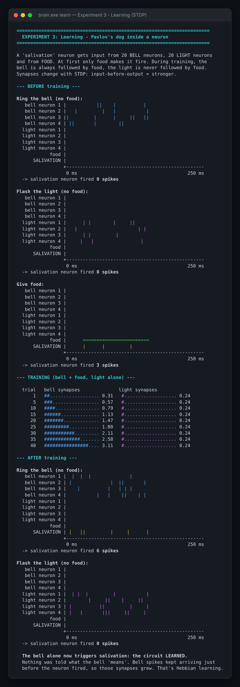
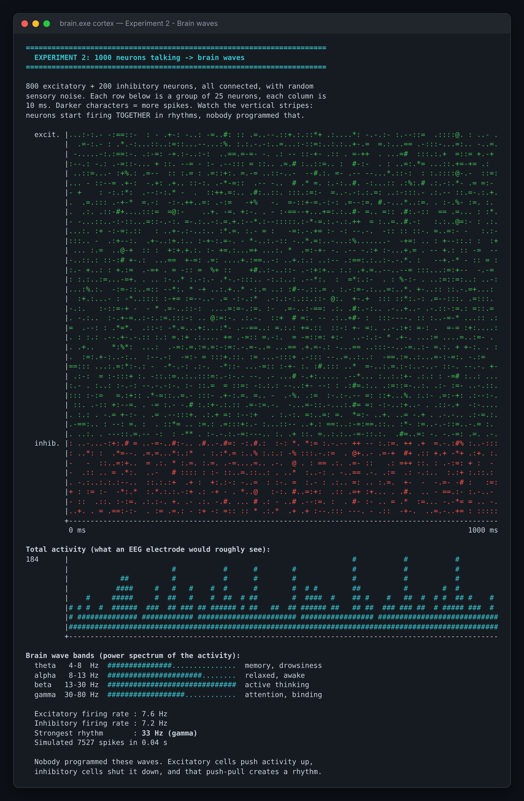
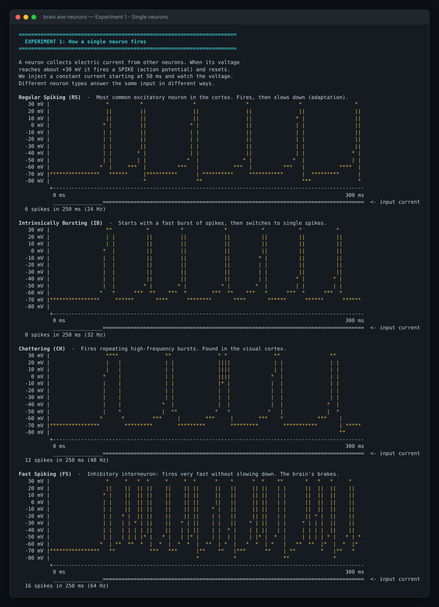
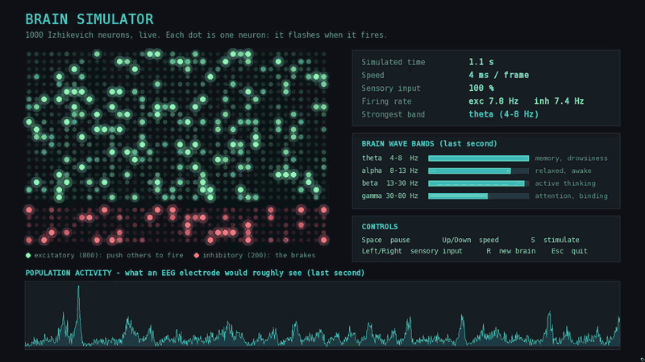

# Brain Simulator (C++)

[](https://github.com/Zakariae4AL/Simulateur-de-cerveau/actions/workflows/build.yml)

*[Version française](README.md)*

A terminal program that shows how the brain works, using real models from computational neuroscience:

1. **Neurons** – how a single neuron fires spikes, and how 4 real neuron types behave differently.
2. **Cortex** – 1000 connected neurons that produce brain waves (alpha, beta, gamma) by themselves.
3. **Learning** – Pavlov's dog: a neuron learns that a bell means food, using STDP (the learning rule real synapses use).

No libraries needed: pure C++17 and ASCII graphics.

## Preview

### 🧠 Experiment 3: a neuron that learns (Pavlov's dog)

Before training, the bell triggers nothing (0 spikes). After 40 bell + food pairings, the bell synapses grow from 0.25 to 3.1 and **the bell alone makes the neuron fire** (6 spikes). The light, never paired with food, is still ignored.

<p align="center"></p>

### 🌊 Experiment 2: 1000 neurons produce brain waves

Green = excitatory neurons, red = inhibitory. The vertical stripes are neurons firing together. Nobody programmed these rhythms.

<p align="center"></p>

### ⚡ Experiment 1: how a neuron fires

Four neuron types get the same input current and each one answers in its own way.

<p align="center"></p>

## Download (Windows)

No compiler needed: download `brain-simulator-windows.zip` from the [Releases](https://github.com/Zakariae4AL/Simulateur-de-cerveau/releases/latest) page, unzip it, and run `brain.exe` (terminal) or `brain-live.exe` (animated window).

## Build & run

With g++ (simplest): `g++ -std=c++17 -O2 -Iinclude src/main.cpp -o brain`

With CMake:

```bash
cmake -S . -B build
cmake --build build --config Release
./build/brain            # interactive menu
./build/brain neurons    # or: cortex | learn | all
./build/brain all --no-color
```

On Windows, the executable is in `build\Release\brain.exe`.

## 🎬 Live version (SFML)

A window where the 1000 neurons flash live when they fire, with an EEG-style trace and brain wave bands updated in real time. In the animation, **S** is pressed: 200 neurons get a stimulus, the whole network bursts, then goes quiet while the neurons recover.

<p align="center"></p>

**Build** (CMake downloads and builds SFML automatically; the first build takes a few minutes):

```bash
cmake -S . -B build-live -DBRAIN_LIVE=ON
cmake --build build-live --config Release
./build-live/brain-live
```

On Windows with MinGW (g++): add `-G "MinGW Makefiles"` to the first command, then run `.\build-live\brain-live.exe`.

**Controls:**

| Key | Action |
|---|---|
| Space | pause / resume |
| Up / Down | simulation speed |
| Left / Right | weaker / stronger sensory input |
| S | stimulate 200 neurons (like a sudden touch) |
| R | build a new random brain |
| Esc | quit |

## Tests

18 unit tests check that the science stays correct: a neuron without input never fires, firing rates are realistic, the spectrum finds a 10 Hz rhythm, STDP learns the bell but not the light, and more.

```bash
cmake -S . -B build
cmake --build build --config Release
ctest --test-dir build --build-config Release --output-on-failure
```

On every push, GitHub Actions builds the project and runs the tests on Windows, Linux and macOS (badge at the top of the page).

## Project structure

```
include/
  neuron.hpp    Izhikevich neuron model + 4 neuron types
  network.hpp   1000-neuron cortical network + EEG-style spectrum analysis
  learning.hpp  Pavlovian conditioning circuit with STDP learning
  plot.hpp      ASCII plotting (voltage traces, bars, histograms)
  color.hpp     ANSI terminal colors
src/
  main.cpp      the three experiments and the menu (terminal)
  live.cpp      the live SFML version
tests/
  tests.cpp     unit tests
.github/workflows/
  build.yml     automatic build + tests (CI)
  release.yml   publishes the .exe files to GitHub Releases
```

## The science

**Neuron model (Izhikevich, 2003).** Two equations describe a neuron's voltage `v` and recovery `u`:

```
v' = 0.04v² + 5v + 140 − u + I
u' = a(bv − u)
if v ≥ 30 mV:  v = c,  u = u + d     (spike!)
```

Changing only `a, b, c, d` gives regular spiking, bursting, chattering or fast-spiking neurons.

**Cortical network.** 800 excitatory + 200 inhibitory neurons, randomly connected, with random sensory noise. Excitation spreads activity, inhibition stops it, and this push-pull makes neurons synchronize into rhythms. The program measures them with a Fourier transform, like an EEG analysis.

**Learning (STDP).** Spike-Timing-Dependent Plasticity (Bi & Poo, 1998):
- input fires just **before** the output → synapse gets **stronger**
- input fires just **after** the output → synapse gets **weaker**

Because the bell always comes just before food makes the neuron fire, bell synapses grow until the bell alone triggers the neuron. The light is never followed by food, so it stays ignored.

## Ideas to extend it

- **Extinction:** ring the bell many times without food. Can you add a rule that makes the neuron "forget"?
- **Pattern recognition:** train output neurons with STDP + lateral inhibition to recognize digits (Diehl & Cook, 2015).
- **Sleep:** reduce the noise input and see slow waves (delta) appear.
- **Performance:** make the network 10,000 neurons with sparse connections and multithreading.

## References

- E. M. Izhikevich, *Simple Model of Spiking Neurons*, IEEE Trans. Neural Networks, 2003
- G. Bi & M. Poo, *Synaptic Modifications in Cultured Hippocampal Neurons*, J. Neuroscience, 1998
