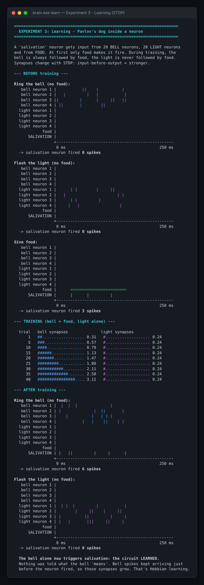
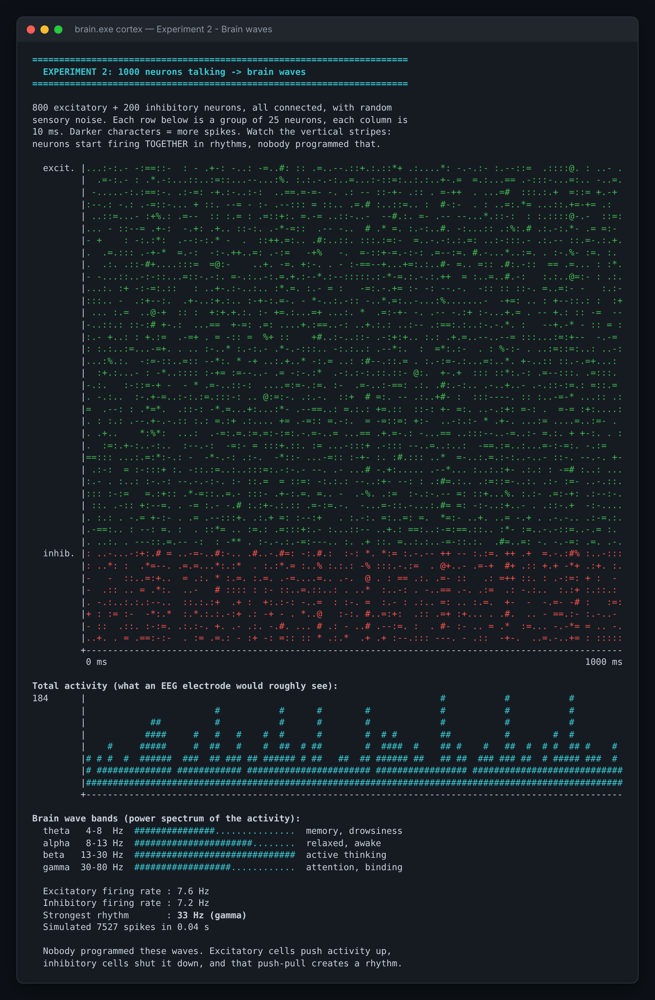
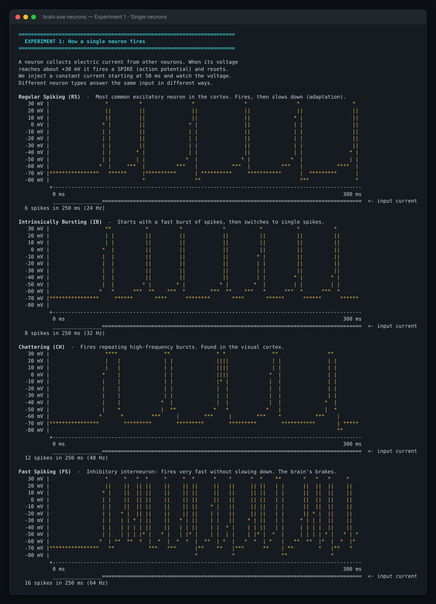
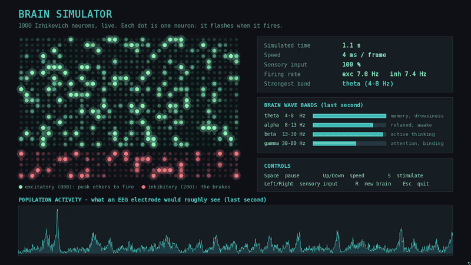

# Simulateur de Cerveau (C++)

[](https://github.com/Zakariae4AL/Simulateur-de-cerveau/actions/workflows/build.yml)

*[English version](README.en.md)*

Un programme en terminal qui montre comment fonctionne le cerveau, avec de vrais modèles issus des neurosciences computationnelles :

1. **Neurones** : comment un neurone émet des potentiels d'action (spikes), et comment 4 vrais types de neurones se comportent différemment.
2. **Cortex** : 1000 neurones connectés qui produisent d'eux-mêmes des ondes cérébrales (alpha, bêta, gamma).
3. **Apprentissage** : le chien de Pavlov. Un neurone apprend qu'une cloche annonce la nourriture grâce à la STDP, la règle d'apprentissage utilisée par les vraies synapses.

Aucune bibliothèque externe : du C++17 pur et des graphiques en ASCII.

## Aperçu

### 🧠 Expérience 3 : un neurone qui apprend (chien de Pavlov)

Avant l'entraînement, la cloche ne déclenche rien (0 spike). Après 40 associations cloche + nourriture, les synapses de la cloche passent de 0,25 à 3,1 et **la cloche seule déclenche le neurone** (6 spikes). La lumière, jamais associée à la nourriture, reste ignorée.

<p align="center"></p>

### 🌊 Expérience 2 : 1000 neurones produisent des ondes cérébrales

En vert les neurones excitateurs, en rouge les inhibiteurs. Les bandes verticales montrent les neurones qui s'activent ensemble. Personne n'a programmé ces rythmes.

<p align="center"></p>

### ⚡ Expérience 1 : comment un neurone émet des spikes

Quatre types de neurones reçoivent le même courant et répondent chacun à leur manière.

<p align="center"></p>

## Télécharger (Windows)

Pas besoin de compiler : téléchargez `brain-simulator-windows.zip` depuis la page [Releases](https://github.com/Zakariae4AL/Simulateur-de-cerveau/releases/latest), décompressez-le, puis lancez `brain.exe` (terminal) ou `brain-live.exe` (fenêtre animée).

## Compiler et lancer

**Avec g++ (le plus simple) :**

```bash
g++ -std=c++17 -O2 -Iinclude src/main.cpp -o brain
./brain
```

Sous Windows (PowerShell) : `g++ -std=c++17 -O2 -Iinclude src/main.cpp -o brain.exe` puis `.\brain.exe`

**Avec CMake :**

```bash
cmake -S . -B build
cmake --build build --config Release
./build/brain
```

Sous Windows, l'exécutable se trouve dans `build\Release\brain.exe`.

**Commandes disponibles :**

```bash
./brain              # menu interactif
./brain neurons      # expérience 1 : un neurone
./brain cortex       # expérience 2 : ondes cérébrales
./brain learn        # expérience 3 : apprentissage
./brain all          # tout lancer
./brain all --no-color
```

Astuce : agrandissez la fenêtre du terminal, certains graphiques font environ 110 caractères de large.

## 🎬 Version live (SFML)

Une fenêtre où les 1000 neurones s'allument en direct quand ils s'activent, avec un tracé type EEG et les bandes d'ondes cérébrales mises à jour en temps réel. Dans l'animation, on appuie sur **S** : 200 neurones reçoivent une stimulation, tout le réseau s'emballe, puis se tait le temps que les neurones récupèrent.

<p align="center"></p>

**Compiler** (CMake télécharge et compile SFML automatiquement, la première fois prend quelques minutes) :

```bash
cmake -S . -B build-live -DBRAIN_LIVE=ON
cmake --build build-live --config Release
./build-live/brain-live
```

Sous Windows avec MinGW (g++) : ajoutez `-G "MinGW Makefiles"` à la première commande, puis lancez `.\build-live\brain-live.exe`.

**Commandes :**

| Touche | Action |
|---|---|
| Espace | pause / reprise |
| Haut / Bas | vitesse de la simulation |
| Gauche / Droite | entrée sensorielle plus faible / plus forte |
| S | stimuler 200 neurones (comme un contact soudain) |
| R | créer un nouveau cerveau aléatoire |
| Échap | quitter |

## Tests

18 tests unitaires vérifient que la science reste correcte : un neurone sans entrée ne s'active jamais, les taux de décharge sont réalistes, l'analyse spectrale trouve un rythme de 10 Hz, la STDP apprend la cloche mais pas la lumière, etc.

```bash
cmake -S . -B build
cmake --build build --config Release
ctest --test-dir build --build-config Release --output-on-failure
```

À chaque push, GitHub Actions compile le projet et lance les tests sous Windows, Linux et macOS (badge en haut de la page).

## Structure du projet

```
include/
  neuron.hpp    modèle de neurone d'Izhikevich + 4 types de neurones
  network.hpp   réseau cortical de 1000 neurones + analyse spectrale (type EEG)
  learning.hpp  circuit de conditionnement pavlovien avec apprentissage STDP
  plot.hpp      graphiques ASCII (tension, barres, histogrammes)
  color.hpp     couleurs du terminal (ANSI)
src/
  main.cpp      les trois expériences et le menu (terminal)
  live.cpp      la version live avec SFML
tests/
  tests.cpp     les tests unitaires
.github/workflows/
  build.yml     compilation + tests automatiques (CI)
  release.yml   publication des .exe sur GitHub Releases
```

## La science derrière le projet

**Modèle de neurone (Izhikevich, 2003).** Deux équations décrivent la tension `v` d'un neurone et sa variable de récupération `u` :

```
v' = 0.04v² + 5v + 140 − u + I
u' = a(bv − u)
si v ≥ 30 mV :  v = c,  u = u + d     (spike !)
```

En changeant seulement `a, b, c, d`, on obtient des neurones à décharge régulière, en rafales (bursting), « chattering » ou à décharge rapide.

**Réseau cortical.** 800 neurones excitateurs et 200 neurones inhibiteurs, connectés aléatoirement, avec un bruit sensoriel aléatoire. L'excitation propage l'activité, l'inhibition l'arrête, et ce va-et-vient synchronise les neurones en rythmes. Le programme les mesure avec une transformée de Fourier, comme dans une analyse EEG.

**Apprentissage (STDP).** Plasticité dépendante du temps d'occurrence des spikes (Bi & Poo, 1998) :
- l'entrée s'active juste **avant** la sortie → la synapse devient **plus forte**
- l'entrée s'active juste **après** la sortie → la synapse devient **plus faible**

Comme la cloche arrive toujours juste avant que la nourriture fasse réagir le neurone, les synapses de la cloche se renforcent jusqu'à ce que la cloche seule déclenche le neurone. La lumière n'est jamais suivie de nourriture, donc elle reste ignorée.

## Idées pour aller plus loin

- **Extinction** : faire sonner la cloche plusieurs fois sans nourriture. Pouvez-vous ajouter une règle qui fait « oublier » le neurone ?
- **Reconnaissance de formes** : entraîner des neurones de sortie avec STDP et inhibition latérale pour reconnaître des chiffres manuscrits (Diehl & Cook, 2015).
- **Sommeil** : réduire le bruit d'entrée et observer l'apparition d'ondes lentes (delta).
- **Performance** : passer à 10 000 neurones avec des connexions creuses et du multithreading.

## Références

- E. M. Izhikevich, *Simple Model of Spiking Neurons*, IEEE Trans. Neural Networks, 2003
- G. Bi & M. Poo, *Synaptic Modifications in Cultured Hippocampal Neurons*, J. Neuroscience, 1998
